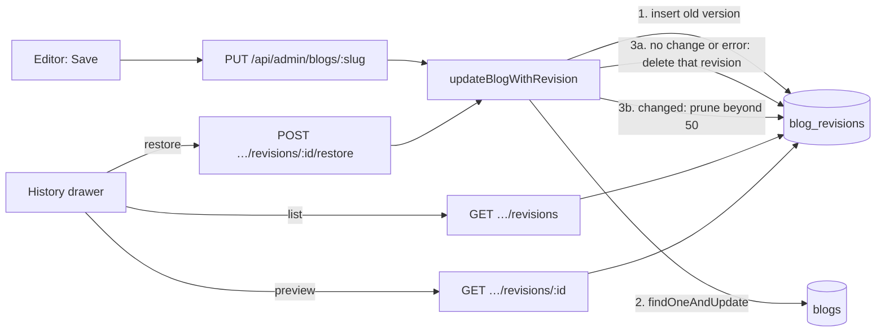

# CogCMS

A self-hostable, multi-site headless CMS built with Next.js 16, React 19, MongoDB/Mongoose, TypeScript and Vitest. Manage blogs, authors, FAQs, whitepapers and release notes in one editorial workspace, and deliver published content to your websites through a versioned API or restricted MongoDB views.

The CMS includes site-scoped users and API keys, editorial previews, stored blog rendering, signed publishing notifications, newsletter and FAQ intake, and optional S3 media uploads. Websites own their presentation. Start with the local demo below or [set up your own installation](docs/DEPLOYMENT.md).

## Local setup

Use Node 22 (`.nvmrc`), npm, **MongoDB 8.2.5** and MongoDB Shell (`mongosh`) for this local recipe. The CMS requires a replica set for transactional paths. Media upload is optional and disabled when the three `S3_*` values are unset.

Get the source and enter the project directory:

```sh
git clone https://github.com/mundra-aman/CogCMS.git
cd CogCMS
```

Then complete these steps from that directory:

1. Create an empty local data directory and start MongoDB with `mongod --replSet rs0 --bind_ip 127.0.0.1 --port 27017 --dbpath <empty-local-directory>`. In a second terminal, connect with `mongosh mongodb://localhost:27017` and run `rs.initiate({_id: 'rs0', members: [{_id: 0, host: 'localhost:27017'}]})` once. Do not point these commands at a shared database.
2. Run `npm ci`, copy `.env.example` to `.env`, and set a new local `CMS_JWT_SECRET` (at least 32 characters) and local `CMS_SEED_ADMIN_PASSWORD` (at least 12 characters). The example email is fictional. Keep `MONGODB_DB_NAME=cms_public_demo` and `MONGODB_URI=mongodb://localhost:27017/?replicaSet=rs0`.
3. Run `npm run seed:admin`, `npm run ensure:indexes`, then `npm run seed:demo`. The demo seed refuses remote MongoDB targets, any database name other than `cms_public_demo`, and an existing site or blog. It creates two fictional sites and 48 blogs; it never overwrites existing records.
4. Run `npm run dev` and open `http://localhost:3003/admin/login`. Sign in with the local admin, then choose **Northstar Studio** or **Harbor Notes** from the site selector. Explore the editors or create a site of your own. The demo has no public website, so its public View links are illustrative.

To reset, stop the app and verify that the target is your disposable local `cms_public_demo` database before dropping it with `mongosh`; then repeat the seed commands. No reset command is bundled so a copied command cannot silently erase another database.

## Checks

Run `npm run typecheck`, `npm test`, and `npm run build` sequentially. Unit and integration tests use a separate temporary MongoDB replica set. If its binary is not cached, `mongodb-memory-server` may download one. Report any setup or baseline failure separately from your changes.

## Feature: blog version history

### Feature overview

Saving a blog post used to overwrite it in place (`Blog.findOneAndUpdate` in `PUT /api/admin/blogs/[slug]`). One bad save, like an accidental deletion, a paste over the wrong section, or a colleague's edit, destroyed the previous text permanently, with no way to see what changed or who changed it.

Version history keeps every replaced version of a post and lets editors inspect and restore them:

- Each save that actually changes a post stores the **previous** version, with who saved it, when, and who replaced it.
- The blog editor has a **History** button that opens a drawer listing earlier versions, newest first.
- Opening a version shows a preview of **what restoring it would change**: a field list (title, tags, SEO fields, …) and a word-level diff of the article text.
- **Restore this version** brings back its content and metadata. The current version is saved to history first, so a restore can itself be undone.
- The newest 50 versions per post are kept. Deleting a post deletes its history.

### Architecture



| File                                      | Role                                                                                                          |
| ----------------------------------------- | ------------------------------------------------------------------------------------------------------------- |
| `models/BlogRevision.ts`                  | Revision model: snapshot of editable fields plus `savedAt`, `savedBy`, `replacedBy`, `reason`, `restoredFrom` |
| `lib/blog-revisions/snapshot.ts`          | Which fields are versioned and which are restorable; normalization and equality                               |
| `lib/blog-revisions/store.ts`             | `updateBlogWithRevision` (the save algorithm), pruning, cascade delete, serializers                           |
| `lib/blog-revisions/diff.ts`              | Field diff and word-level text diff (LCS), HTML to text for display                                           |
| `lib/blog-revisions/lookup.ts`            | Site- and post-scoped lookups used by all three routes                                                        |
| `app/api/admin/blogs/[slug]/route.ts`     | **Changed:** PUT now saves through `updateBlogWithRevision`; DELETE also deletes history                      |
| `app/api/admin/blogs/[slug]/revisions/…`  | `GET` list, `GET` one version with restore preview, `POST …/restore`                                          |
| `components/admin/blog-history-panel.tsx` | History drawer; opened from a new **History** button in `app/admin/dashboard/blogs/new/page.tsx`              |

**The save algorithm (`updateBlogWithRevision`).**

1. Copy the current post's editable fields and insert them as a revision.
2. Apply the update.
3. If the update threw (for example a duplicate slug) or the post vanished, delete that revision and rethrow.
4. If the saved post is identical to the snapshot (a no-op save), delete the revision.
5. Otherwise prune revisions beyond 50.

**Restore.** The restore route loads the post by slug **and** the active site, then loads the revision by `_id`, `siteId` **and** `blogId`. It checks the saved author is still usable (same rule as a normal save), copies the restorable fields, sanitizes and re-renders the content exactly like `PUT`, and saves through the same `updateBlogWithRevision`, with `reason: 'restore'`. A published post triggers the existing `content.updated` webhook.

**Site isolation.** All routes use `withAdmin` with the default active-site resolution (the same access as the blog editor itself: admins and editors assigned to the site). Every revision query filters on `siteId` and `blogId`, and the index leads with `siteId`. A revision id from another site or another post returns 404.

### Design decisions and trade-offs

- **Snapshot before update, not after.** If the process dies between the two writes, the worst case is one extra revision identical to the current post. Writing after would risk losing exactly the version the feature exists to protect.
- **No transaction.** A MongoDB transaction would make the two writes atomic, but the ordering above already fails safe without one, and it avoids retry and write-concern handling on the hot save path. The trade-off is that a crash can leave a harmless duplicate.
- **History failures block the save.** If the revision cannot be written, the save is refused (500). Silently saving without history would defeat the feature. This is the opposite choice to, say, a webhook log, where observation must never block the main action.
- **Full snapshots vs. diffs.** Full snapshots make listing and restoring trivial and robust. They cost storage, bounded by the 50-version cap. Posts are text, so 50 copies is typically well under a megabyte.
- **Separate collection vs. an array on the blog.** An embedded array would bloat every blog read, including the public API and published views. A separate collection leaves those untouched.
- **Keyed by `blogId`, not slug.** The slug is editable, and history must follow the post when it moves.
- **Restore excludes slug and status.** Restoring old wording should not silently move a live post to an old URL, or publish and unpublish it. Both are shown in the list, and both can still be changed normally in the editor.
- **`rendered` is not stored.** It is derived from `content`, so restore re-renders it with the current pipeline instead of reviving stale HTML.
- **No-op saves are not recorded.** Pressing Save twice doesn't flood history with duplicates.
- **Diff computed on the server, compared as text.** Diffing rendered HTML would show tag noise, so HTML is reduced to text first, for display only (React renders it escaped). The LCS table is limited to 4M cells, with common prefix and suffix trimmed first, so typical edits to long posts stay cheap and huge rewrites degrade to "changed too much to compare" instead of exhausting memory.
- **Blogs only.** Blogs are the richest and most edited content. The snapshot, store and diff pieces are generic enough to extend to whitepapers and release notes.

### Technology choices

No new dependencies.

- **Mongoose** (existing) for the model and index. Snapshot sub-schema validation mirrors the `Blog` schema.
- **Hand-written word diff** (LCS, about 60 lines) instead of a library such as `diff`/`jsdiff`. It keeps the dependency count unchanged, and it's fully covered by tests. A library would be the right call if line or character diffs or patch output were needed.
- **Existing `sanitizeBlogHtml` and `renderBlogSnapshot`** so restored content passes through exactly the same safety and rendering path as a normal save.
- **Existing `assertBlogAuthorIsUsable`** so restore cannot bring back an author who was deleted or unpublished.
- **Existing `notifySiteWebhook`** so consumer websites refresh after restoring a published post.
- **Vitest.** Pure unit tests for snapshot and diff, mocked-model unit tests for the save ordering, and integration tests on the existing `mongodb-memory-server` harness.

### Setup and usage

1. Complete the normal local setup above, then run `npm run ensure:indexes` again so the `blog_revisions` index is created. This app sets `autoIndex: false`.
2. Open any existing post in the editor and save a change. Click **History** in the top bar: the previous version is listed.
3. Click a version to preview it. Red text will be removed and green text will come back. Click **Restore this version**, and the editor reloads with the restored content. The version you replaced is now at the top of the list, so you can undo.

API (admin session with access to the active site):

- `GET /api/admin/blogs/:slug/revisions` returns `{ items, limit }` (summaries only, no bodies).
- `GET /api/admin/blogs/:slug/revisions/:revisionId` returns `{ revision, snapshot, restoreChanges, contentDiff, contentDiffTooLarge }`.
- `POST /api/admin/blogs/:slug/revisions/:revisionId/restore` returns `{ blog, changed }`. It returns 400 if the saved author is no longer usable, and 404 for a revision from another post or site.

### Tests

- `lib/blog-revisions/snapshot.test.ts`: field selection, normalization, equality, slug and status never restorable.
- `lib/blog-revisions/diff.test.ts`: field diff, HTML to text, word diff correctness (both texts rebuild exactly from the segments), prefix and suffix trimming on a 20,000-word post, memory cap.
- `lib/blog-revisions/store.test.ts`: save ordering with mocked models (insert before update), discard on failure, no-op and vanished post, refuse save when history can't be written, pruning.
- `tests/integration/api/admin-blog-revisions.test.ts`: recording with who and when, no revision for no-op or failed saves, slug change, 50-version cap, cascade delete, restore preview and diff, restore keeping slug and status and re-rendering, undo, webhook on published restore, no-op restore, deleted-author refusal, cross-post and cross-site isolation, 400/403/404 cases.
- Existing tests updated: admin route inventory (which also checks the new routes reject anonymous requests), webhook wiring, model registry and indexes.

### Limitations and future work

- **Blogs only.** Extend to whitepapers, release notes and FAQs using the same `lib/blog-revisions` pieces.
- **Every save is a version.** Rapid successive saves by one person could be coalesced (for example one version per user per five minutes).
- **Author shows as an id** in the change preview. Resolve it to the author's name.
- **Restore is whole-version.** Restoring a single field (for example only the excerpt) would be a natural next step.
- **Concurrent editors.** Two people saving the same post at once both succeed, last write wins, as before. Both previous versions are kept, so nothing is lost, but an optimistic-concurrency check (`updatedAt` precondition) would warn the second editor.
- **Deleting a post deletes its history.** A soft-delete or trash could keep history for undelete.

## Boundaries

- Admin routes use a login session and active-site selection. `/api/v1` uses site-scoped keys and exposes published content only.
- Website rendering stays in the consumer; this repository owns editorial UI, content models and publication contracts. See [architecture](docs/ARCHITECTURE.md).
- Local editorial use needs no cloud account or paid service. Optional media and hosted installations use your own resources. See [deployment notes](docs/DEPLOYMENT.md).
- Keep credentials out of the repository. `.env.example` contains placeholders only.

Read [CONTRIBUTING.md](CONTRIBUTING.md) to contribute. The optional [assignment](ASSIGNMENT.md) provides a bounded example contribution; it does not define the scope of the product.

## Community and maintenance

- [Support](SUPPORT.md): questions, bug reports and feature requests.
- [Code of Conduct](CODE_OF_CONDUCT.md): participation and reporting concerns.
- [Security policy](SECURITY.md): private vulnerability reporting and maintenance scope.
- [Changelog](CHANGELOG.md): release status and notable changes.

This is the initial public-source preparation. There are no published stability or long-term support guarantees; review the deployment guide before running an installation with real data.

Licensed under the [MIT License](LICENSE), copyright 2026 Aman Mundra. See [source provenance](PROVENANCE.md) for the project's origins. This source distribution includes no private installation history or customer dataset.
